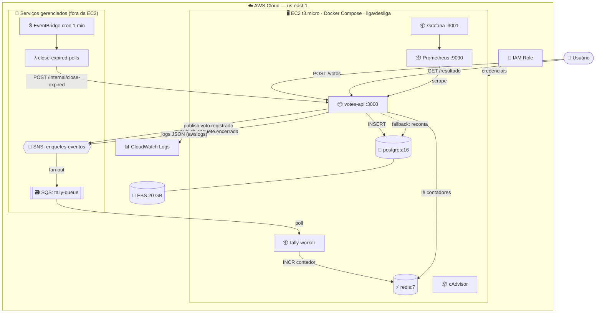

# Sistema de Enquetes — Arquitetura de Microserviços com Mensageria e Serverless

Trabalho acadêmico de arquitetura de microserviços: enquetes estilo WhatsApp
(título, descrição, opções A/B/C e prazo), com voto assíncrono via mensageria,
encerramento automático por função serverless e observabilidade completa.

> **Deploy na AWS passo a passo (console):** veja [`DEPLOY.md`](./DEPLOY.md)
> **Trocar de laboratório / recriar do zero:** [`docs/NOVO-LAB.md`](./docs/NOVO-LAB.md)
> **Testes:** [`docs/TESTES.md`](./docs/TESTES.md)
> **Infraestrutura como código:** [`infra/terraform`](./infra/terraform)

## Deploy em 1 comando (AWS CLI)

```bash
export AWS_PROFILE=lab2
export INSTANCE_PROFILE=LabInstanceProfile
export REPO_URL=https://github.com/SEU-USUARIO/votacao-enquete.git
./scripts/deploy-cli.sh          # cria SNS, SQS, EC2, Lambda, EventBridge...
./scripts/deploy-cli.sh destroy  # apaga tudo
```

---

## 1. Visão geral

| Item | Escolha |
|---|---|
| Arquitetura | Microserviços |
| Execução | Docker Compose em **EC2** (1 instância) |
| Mensageria | **Amazon SNS** (pub/sub) → **Amazon SQS** (fila) |
| Serverless | **AWS Lambda** disparada por **EventBridge** (cron 1 min) |
| Banco | PostgreSQL 16 em container, volume no **EBS** (persistente) |
| Cache/contadores | Redis 7 em container |
| Observabilidade | Prometheus + Grafana + cAdvisor + CloudWatch Logs |
| IaC | Terraform (~10 recursos) |

---

## 2. Desenho da arquitetura



**Fluxo do voto**
1. `POST /enquetes/{id}/votos` valida CPF, prazo e opção.
2. Grava o voto no Postgres (`UNIQUE(enquete_id, cpf)`).
3. Publica `voto.registrado` no SNS e responde `201` sem esperar a contabilização.
4. SQS bufferiza; `tally-worker` consome, deduplica (idempotência por `voto_id`) e faz `INCR` no Redis.
5. `GET /resultado` lê os contadores; se o Redis estiver vazio/fora, reconta do Postgres.
6. EventBridge dispara a Lambda a cada minuto → fecha enquetes vencidas → publica `enquete.encerrada`.

---

## 3. Endpoints

| Método | Rota | Descrição |
|---|---|---|
| GET | `/health` · `/health/ready` | Health checks (Docker) |
| GET | `/metrics` | Métricas Prometheus |
| POST | `/enquetes` | Cria enquete (título, descrição, opções, duração, **anônima?**, **máx. de escolhas: 1 ou 2**) |
| GET | `/enquetes` | Lista enquetes |
| POST | `/enquetes/{id}/votos` | Registra voto (`votante_id`, `opcao_ids[]`, `nome` se identificada) |
| GET | `/enquetes/{id}/resultado` | Resultado com percentuais |
| POST | `/internal/close-expired` | Chamado pela Lambda (token no header) |

<details>
<summary>Exemplos de requisição</summary>

```bash
# criar enquete anônima, voto único
curl -X POST http://IP:3000/enquetes -H 'Content-Type: application/json' -d '{
  "titulo": "Onde vamos almoçar?",
  "descricao": "Escolha o restaurante de sexta",
  "duracao_minutos": 30,
  "opcoes": ["Opção A - Pizza", "Opção B - Japonês", "Opção C - Vegetariano"],
  "anonima": true,
  "max_escolhas": 1
}'

# criar enquete identificada, podendo votar em 2 opções
curl -X POST http://IP:3000/enquetes -H 'Content-Type: application/json' -d '{
  "titulo": "Quais temas para o seminário?",
  "duracao_minutos": 1440,
  "opcoes": ["Kubernetes", "Mensageria", "Observabilidade", "IaC"],
  "anonima": false,
  "max_escolhas": 2
}'

# votar (votante_id = uuid do navegador; sem CPF)
curl -X POST http://IP:3000/enquetes/{ID}/votos -H 'Content-Type: application/json' \
  -d '{"votante_id":"3f2b8c1e-9a4d-4e8b-9c7a-1b2c3d4e5f60",
       "nome":"Maria Silva",
       "opcao_ids":["{OPCAO_A}"]}'

# resultado
curl http://IP:3000/enquetes/{ID}/resultado
```
</details>

---

## 3.1. Modelo de votação (anônima × identificada, 1 ou 2 escolhas)

| Campo da enquete | Valores | Efeito |
|---|---|---|
| `anonima` | `true` (padrão) / `false` | `true`: a tela não pede identificação. `false`: exige `nome` e mostra a lista "quem já votou" |
| `max_escolhas` | `1` (padrão) / `2` | quantas opções cada pessoa pode marcar |

**Sem CPF.** A deduplicação usa um `votante_id` (uuid aleatório gerado no navegador e
guardado em `localStorage`), garantido por `UNIQUE (enquete_id, votante_id, opcao_id)`.
O limite de escolhas é validado em transação com `pg_advisory_xact_lock`, impedindo
duplo clique/corrida. Trade-off documentado: limpar o navegador gera novo id — em
enquete anônima não há como identificar a pessoa por definição.

## 4. Alta disponibilidade

A HA é obtida em três frentes complementares:

| Camada | Mecanismo |
|---|---|
| Containers | `restart: always`, `healthcheck` em todos os serviços, `depends_on` com condição `service_healthy`, shutdown gracioso (SIGTERM) |
| Dados | Postgres com volume nomeado no **EBS** (sobrevive a stop/start); Redis com **AOF** (`appendonly yes`) |
| Mensageria | SQS retém mensagens por 4 dias: se o worker cair, **nenhum voto se perde**; reentrega após falha |
| Degradação | Se o Redis cair, `/resultado` reconta do Postgres (`fonte_contagem: postgres_fallback`) |
| Idempotência | `SET NX voto_processado:{voto_id}` evita contagem dupla em reentregas |
| Serverless | Lambda e SNS/SQS são gerenciados e multi-AZ por natureza — continuam funcionando com a EC2 parada |

**Limitação declarada:** instância única = ponto único de falha de compute.
O desenho é escalável horizontalmente (2ª EC2 + ALB) sem alteração de código.

### Demonstração de resiliência
```bash
docker stop tally-worker     # a fila cresce (visível no dashboard)
docker start tally-worker    # fila zera, votos processados, nada perdido
docker restart votes-api     # volta em segundos via restart: always
```

---

## 5. Observabilidade

| Sinal | Ferramenta | Onde ver |
|---|---|---|
| Logs da API e do worker (JSON) | Docker `awslogs` → CloudWatch Logs | `/votacao/votes-api`, `/votacao/tally-worker` |
| Logs da Lambda | CloudWatch Logs | `/aws/lambda/votacao-close-expired-polls` |
| Métricas de aplicação | Prometheus (`/metrics` nas duas aplicações) | `votos_aceitos_total`, `votos_processados_total`, `http_request_duration_seconds` |
| Métricas de containers | cAdvisor | CPU/memória por container |
| Métricas de infraestrutura | CloudWatch | `AWS/SQS ApproximateNumberOfMessagesVisible`, EC2 |
| Dashboard | **Grafana** (provisionado em `observability/grafana`) | `http://IP:3001` — dashboard "Votação — Visão Geral" |
| Alarme | CloudWatch Alarm | > 100 mensagens na fila por 5 min |

O dashboard é provisionado como código (`observability/grafana/dashboards/votacao.json`) e sobe automaticamente:
total de votos, votos/minuto (API vs worker), latência p50/p95/p99, votos por opção e CPU/memória por container.

---

## 6. Decisões de arquitetura (e o que foi descartado)

| Decisão | Alternativa descartada | Justificativa |
|---|---|---|
| Docker Compose em EC2 única | EKS / ECS Fargate | Volume ≤ 50 votos simultâneos; Fargate não tem disco persistente (Postgres exigiria RDS/EFS); ALB obrigatório custaria mais que o ambiente inteiro |
| Postgres em container + EBS | RDS Multi-AZ | RDS desliga por no máx. 7 dias, leva minutos para voltar e cobra storage parado. EBS + volume Docker resume em segundos |
| Redis em container | ElastiCache / MemoryDB | Contadores são derivados e reconstruíveis do Postgres — durabilidade gerenciada não se paga |
| Sem DLQ | SQS + Dead Letter Queue | Consumer idempotente e trivial; retenção de 4 dias cobre a janela de falha. Complexidade > benefício nesta escala |
| SNS + SQS (fan-out) | Só SQS ou só SNS | SNS não retém mensagem; SQS não faz fan-out. Juntos dão buffer + notificação para múltiplos consumidores |
| Lambda via HTTP para a API | Lambda na VPC acessando o Postgres | VPC exigiria NAT Gateway (~US$32/mês); o Postgres não fica exposto à internet |
| Sem Elastic IP | EIP fixo | IPv4 público ocioso custa ~US$3,60/mês mesmo com a instância parada; `scripts/up.sh` atualiza a URL da Lambda a cada start |

---

## 7. Estrutura do repositório

```
.
├── services/
│   ├── votes-api/            # API REST (camadas: rotas, db, redis, sns, métricas, logger)
│   └── tally-worker/         # consumer SQS
├── db/init/01-schema.sql     # schema criado no primeiro boot do Postgres
├── lambda/close-expired-polls/  # função serverless (Node 20, sem dependências)
├── observability/
│   ├── prometheus.yml
│   └── grafana/              # datasource + dashboard provisionados
├── infra/terraform/          # EC2, EBS, IAM, SNS, SQS, Lambda, EventBridge, CloudWatch
├── scripts/
│   ├── up.sh / down.sh       # liga/desliga a instância e atualiza a Lambda
│   └── demo.sh               # gera votos para demonstrar dashboard e logs
└── docker-compose.yml
```

---

## 8. Custo (20 h de uso/mês)

| Item | Custo |
|---|---|
| EC2 t3.micro (20 h) | ~US$0,40 (US$0 no free tier) |
| EBS 20 GB gp3 | ~US$1,60/mês |
| IPv4 público (só quando ligada) | ~US$0,10 |
| SNS + SQS + Lambda + CloudWatch | free tier |
| **Total** | **~US$2/mês** |

Rotina: `./scripts/up.sh` → usar → `./scripts/down.sh`. Nunca use `terraform destroy`
no fim do dia (o EBS está com `delete_on_termination = false`, mas o destroy
remove o recurso do state).
